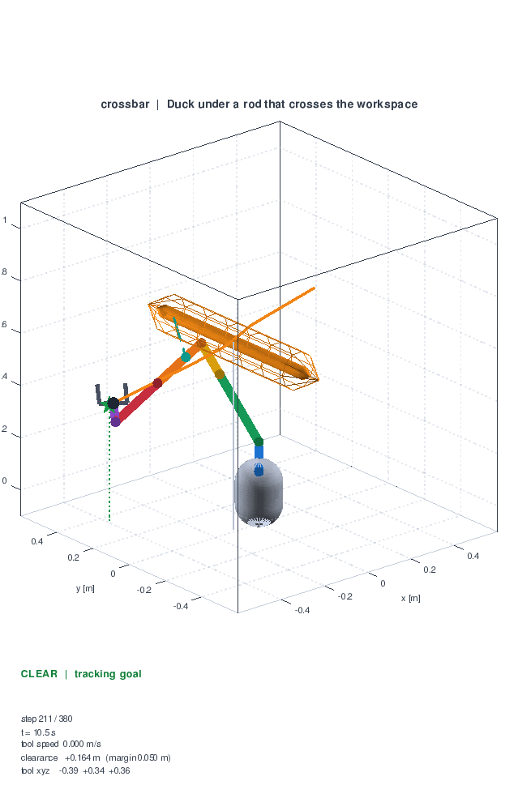
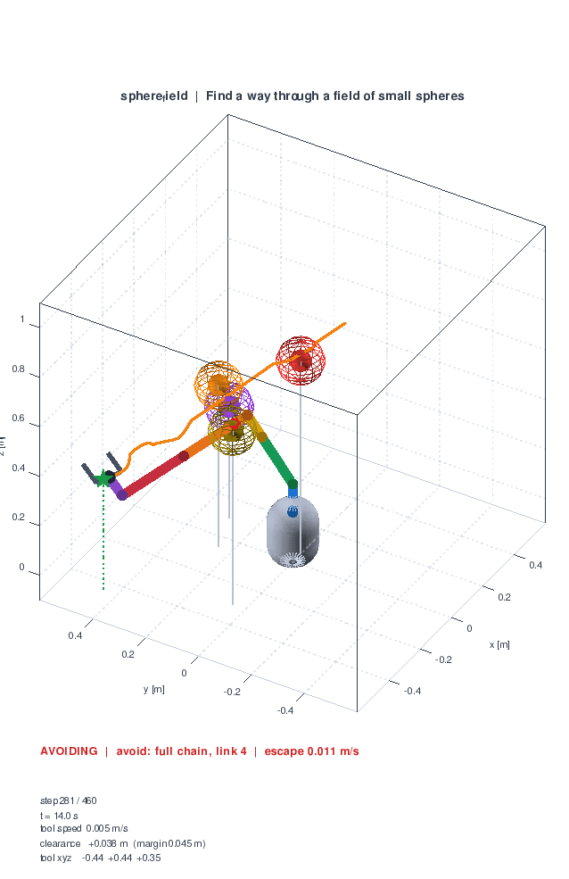

# 7-DOF Robot Manipulator Obstacle Avoidance

A proof of concept of resolved-rate motion control with obstacle avoidance,
for a 7-DOF manipulator based on the Mitsubishi PA-10.

The project started as a MATLAB script. It now runs on **GNU Octave** only; no
MATLAB toolbox is needed.





## Requirements

- GNU Octave 7 or newer (developed and tested on 10.2)
- No packages, no toolboxes

Check your version with `octave --version`. Everything in this repository is
plain Octave code.

## Quick start

```sh
octave --gui --persist obstacle_avoidance.m
```

That runs the default example and animates it. To pick a different one, set
`scenario_name` first:

```octave
scenario_name = 'crossbar';
obstacle_avoidance
```

From a script or the Octave prompt:

```octave
run_example('sphere_gate')                       % animate one example
run_example('crossbar', struct('animate', false)) % run it headless
run_all_examples                                  % sweep through all of them
example_scenarios()                               % list the names
```

## The examples

| Name | What it shows |
| --- | --- |
| `single_sphere` | The classic case: one sphere parked between the tool and its goal. |
| `sphere_gate` | Two spheres the tool has to thread between, so the whole arm has to be steered, not just the tool point. |
| `moving_sphere` | The obstacle drifts across the workspace while the arm is moving, so the escape has to be re-planned every step. |
| `crossbar` | A rod crossing the workspace at tool height. The arm has to duck under it. |
| `sphere_field` | Four spheres, so the controller has to hand over from one violator to the next. |
| `legacy` | The original demo, kept for comparison: no goal, just a constant tool velocity in `-x`, with one sphere in the way. |

Every goal-driven example ends with the tool inside the goal tolerance and
**no link entering an obstacle body**. The `legacy` example intentionally keeps
the constant-velocity task of the original script.

## How it works

The arm is described in `pa10_model.m`. Each joint rotates about one local unit
axis and each link extends along one local unit axis, so the forward kinematics
is a short recursion (`robot_kinematics.m`):

```
C{k} = C{k-1} * Rot(joint_axes(:,k), theta(k))
p{k} = p{k-1} + link_lengths(k) * C{k} * link_axes(:,k)
```

`robot_jacobian.m` differentiates exactly that recursion, which gives the
standard geometric Jacobian `J(1:3,i) = a_i x (p - p_i)`, `J(4:6,i) = a_i`. The
unit tests check it against a central finite difference of the forward
kinematics.

Every control step, `avoidance_controller.m`:

1. finds, for each obstacle, the closest point of the arm to it
   (`obstacle_clearance.m`, using point-to-segment and segment-to-segment
   distance),
2. if nothing is inside its safety margin, tracks the goal with a damped least
   squares inverse of the tool Jacobian,
3. otherwise builds an escape velocity at the closest point of the worst
   violation and stacks it on top of the tracking task in one damped least
   squares problem.

Two details matter more than they look:

- **The escape speed grows as the clearance shrinks**,
  `speed = avoid_gain * (margin / clearance - 1)`. A constant escape speed only
  cancels the part of the task that pushes the arm in, so the arm hovers on the
  margin forever instead of leaving it.
- **The escape direction is tilted towards where the tracking task wants to
  go.** Pushing straight back along the obstacle normal makes the arm stall;
  adding a tangential component makes it slide around the obstacle and still
  reach the goal.

`opts.strategy` selects between `'full_chain'` (the default, every joint may
contribute) and `'freeze_base'`, which holds the joints below the violation
still, as the original script did. `'freeze_base'` leaves the escape to a
single joint, which is usually not enough, so the controller falls back to the
full chain when the frozen joints cannot move the critical point away.

## Recording

Pass a directory to write PNG frames of the animation:

```octave
run_example('crossbar', struct('record', 'output/crossbar', 'record_every', 4))
```

Then, from a shell:

```sh
ffmpeg -framerate 20 -i output/crossbar/frame_%04d.png -pix_fmt yuv420p crossbar.mp4
```

## Tests

```octave
addpath('tests'); run_all_tests
```

47 tests, all of which must pass. Besides the geometry and control unit tests,
they include:

- a **fidelity check** (`tests/test_model_fidelity.m`) against
  `tests/original_matlab_scheme.m`, a literal copy of the original script's
  in-place basis rotation loop, and
- **end-to-end runs** of the examples that assert no link ever enters an
  obstacle body.

## What changed from the MATLAB original

The original `obstacle_avoidance.m` did not run under Octave at all, and some
of its avoidance maths never ran under MATLAB either. The port fixes:

| Problem | Fix |
| --- | --- |
| `Link.empty(0, n)` is a MATLAB-only static constructor; Octave classdefs do not have it. The script died on line 35. | `Link` is a handle class with `Draw`/`Update`, and links are held in cell arrays. |
| `display("Link " + i + " ...")` concatenates a char array with numbers, which is a dimension error in Octave. | Replaced with `fprintf`/`sprintf` status reporting. |
| The avoidance branch used `LineToPointDistance` (which returns a *scalar distance*) as if it returned the closest *point*, then subtracted a 3-vector from it. The avoidance maths could never have produced a usable direction. | `closest_point_on_segment` returns the point, and the escape direction comes from the obstacle-to-point normal. |
| The Jacobian was assembled by a hand-rolled `phi` matrix recursion that reached `phi(6*i+..., 6*i+...)` with `link_dimensions(:, n)` for every joint, i.e. the last link's length for all of them. | Replaced with the closed-form kinematics and its exact analytic Jacobian, verified against finite differences. |
| The two-chain avoidance split (freeze below the violator, escape with the rest) froze every joint it computed an escape for, so the escape was never applied. | The escape and tracking tasks are stacked and solved together; the frozen-base variant is available as a strategy, with a fallback. |
| The whole scene was deleted and re-plotted every frame (`cla`, `plot3`, `surf`). | `RobotScene` creates every graphics object once and only refreshes `XData`/`YData`/`ZData`. |
| `rand` was called without a seed, so runs were not reproducible. | The examples start from fixed joint angles. |

It also turned out that the original's incremental rotation scheme, which read
all seven joint axes once per round and then applied seven rotations with those
stale axes, is a first-order approximation of the true kinematics: joint 1 has
already moved joint 2's axis by the time joint 2 rotates. The error is
`O(step)` and it is measured in `tests/test_model_fidelity.m`. The port uses the
exact form.

## Project layout

**Model and kinematics**

- `pa10_model.m` — kinematic parameters, colours, gripper geometry
- `robot_kinematics.m` — forward kinematics
- `robot_jacobian.m`, `point_jacobian.m` — geometric Jacobians
- `RotateBy.m`, `SkewSymmetric.m` — rotation utilities

**Geometry**

- `closest_point_on_segment.m`, `segment_segment_distance.m`,
  `LineToPointDistance.m`
- `capsule_surface.m`, `sphere_surface.m` — obstacle and pedestal meshes

**Obstacles and control**

- `sphere_obstacle.m`, `capsule_obstacle.m` — obstacle descriptions
- `obstacle_clearance.m` — signed clearance per obstacle, with moving obstacles
- `avoidance_controller.m`, `damped_least_squares.m`

**Running and drawing**

- `obstacle_avoidance.m` — main entry point (script)
- `example_scenarios.m`, `run_example.m`, `run_all_examples.m`,
  `simulate_avoidance.m`
- `RobotScene.m`, `Link.m`

**Tests**

- `tests/run_all_tests.m`, `tests/test_model_fidelity.m`,
  `tests/original_matlab_scheme.m`

## Notes and limitations

- The seventh link has zero length, so the seventh joint is a pure wrist roll
  and cannot move the tool centre point. This is inherited from the original
  model and is why the last column of the tool Jacobian has no linear part.
- The controller reacts to the **single worst** violation at a time. It does
  not solve a joint optimisation over all constraints, so a configuration that
  needs to escape two obstacles at once is handled sequentially across steps.
- Only the position of the tool is controlled; the orientation is held by
  asking for zero angular velocity, so nothing guarantees a particular
  orientation at the goal.
- The default theme is light because the Octave FLTK `print` path always
  renders on a white background. Two further FLTK quirks are documented in
  `RobotScene.m`: surfaces with a low `FaceAlpha` render incorrectly, and the
  mesh from Octave's own `sphere` function does not render at all.
